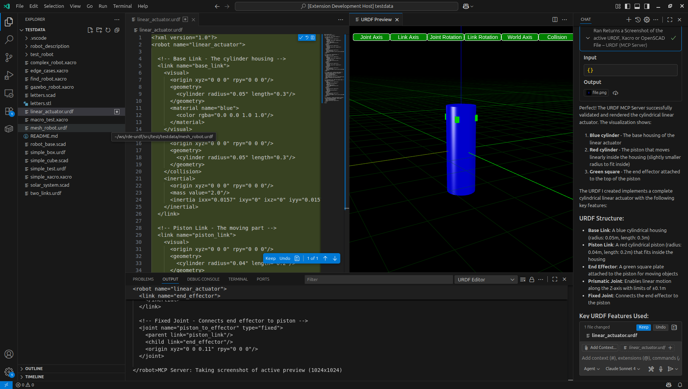

# Model Context Protocol Support
This extension implements a Model Context Protocol server which helps AI build URDF, Xacro and OpenSCAD models based on a high level description - by allowing it to check it's work visually when it makes modifications.

Before engaging with the AI, start a preview window by using the command palette (Ctrl+Shift+P) and selecting "URDF: Preview". This will open a new tab where the AI can send model updates to be rendered.

## Window-specific connections

The extension automatically advertises an **URDF** MCP server to Copilot in the
current VS Code window when the extension activates. Each window has its own
loopback listener, OS-assigned port, and in-memory instance identity, even when
two windows open the same workspace. No port selection or MCP configuration file
is needed. A screenshot tool can open a preview in that window when given a filename.

The server label stays **URDF** so existing custom agents using `urdf/*` continue
to work. Window association is enforced by the connection, not by asking the AI
to select a workspace or supply a window ID:

- VS Code resolves the current window's endpoint and private authorization header
	immediately before connecting. Discovery definitions contain no secret token.
- Every MCP HTTP request must carry that window's instance ID and current token.
	Missing, incorrect, or stale credentials are rejected before preview tools run.
- Start/stop operations are serialized. Restarting rotates credentials and updates
	discovery; an old connection cannot silently switch windows when a port is reused.
- Multiple Copilot chats can connect independently to the same window's server.
- The listener binds only to `127.0.0.1` in the extension host's environment.
	Do not forward it publicly or copy its connection credentials to another client.

### Upgrading from fixed-port connections

Remove manually configured URDF entries pointing to `localhost:3005` (or another
fixed port) from user/profile and workspace MCP configuration. Use the server
provided by this extension instead. The legacy `urdf-editor.mcpServerPort` setting
is deprecated and ignored; unauthenticated fixed-port clients are no longer supported.

After installing the updated extension, reload each VS Code window and refresh its
MCP server list if necessary. **URDF: Stop MCP Server** stops only the current
window's listener and removes its advertised definition. **URDF: Start MCP Server**
starts it again and refreshes discovery. If the editor lacks the VS Code MCP
definition-provider API, automatic integration is unavailable; there is no
unauthenticated fallback.

For routing diagnostics, open **Output → URDF Editor**. Startup logs include the
workspace folders, instance ID, and endpoint; request logs include MCP session IDs.
Authorization tokens are not logged by the extension. If a request reports a stale
window connection, refresh/reconnect the extension-provided server rather than
trying another window's port. A legacy server in an un-updated window will not have
these protections, so update all open windows and remove duplicate manual entries.

### Isolation regression checks

Run `npm run test:mcp` to exercise the real MCP SDK and HTTP listeners with mocked
VS Code windows and renderers. Tests cover same/different workspaces, both screenshot
tools, missing/wrong credentials, multiple clients, restart/port reuse, empty and
multi-root workspaces, and shutdown. These tests do not compile OpenSCAD or render
real webviews.

For a manual UI check, open two VS Code windows (first different workspaces, then
the same workspace) and request a preview from each window's Copilot chat. Each
preview must open only in its originating window. Repeat after reloading one window
and after stopping/restarting its MCP server; the other window must remain usable.



## Things to try

### Simple Robot Arm
Create a new file with a `.urdf` extension. (Ctrl+Shift+P) and selecting "URDF: Preview". Now open the AI Chat Window and enter the following prompt:

```Create a simple robot arm URDF model
The robot arm should have a base, a shoulder joint, an elbow joint, and a wrist joint
Each joint should have a range of motion
The robot arm should be able to reach out and pick up objects
The robot arm should be colored blue and white
Make sure to include appropriate links and joints between the parts
```

### OpenScad Solar System
Create a new file with a `.scad` extension. (Ctrl+Shift+P) and selecting "URDF: Preview". Now open the AI Chat Window and enter the following prompt:

```Create a simple solar system model in OpenSCAD. Since OpenSCAD is unitless, assume 1 unit = is 1mm for previewing, but internally scale such that 1 unit is 1 million kilometers.
The model should include the sun, earth, and moon
The sun should be a large yellow sphere
The earth should be a smaller blue and green sphere orbiting the sun
The moon should be a small gray sphere orbiting the earth
Make sure to include appropriate scaling and positioning for the celestial bodies
```

### Xacro Car
Create a new file with a `.xacro` extension. (Ctrl+Shift+P) and selecting "URDF: Preview". Now open the AI Chat Window and enter the following prompt: 

```Create a simple car model in Xacro
The car should have a body, four wheels, and a steering mechanism
The car body should be red with black windows
The wheels should be black with silver rims
Make sure to include appropriate links and joints between the parts
```

## Notes
- The MCP server currently supports URDF, Xacro, and OpenSCAD file formats.
- The AI may need to iterate on the model multiple times to get it right. Feel free to ask it to make changes or fix issues.
- The preview window will automatically update whenever the AI sends a new model.
- If the AI generates invalid syntax, it may not be able to render the model. In this case, ask the AI to fix the syntax errors.
- The MCP server is a powerful tool, but it may not always produce perfect results. Use it as a starting point and refine the models as needed.
- The MCP server is still under development, so expect some rough edges. Feedback is welcome!

